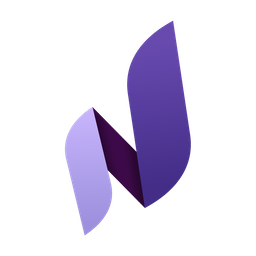

<div align="center">



# Nyxs

**A desktop AI agent that codes with you, on your own machine.**

It reads and edits your code, runs commands, uses git, drives a built-in browser and your
desktop, and asks for permission the way you choose. Bring any of 20+ model providers, or the
coding CLIs you already pay for.

[](https://github.com/nyxs-code/nyxs-code/actions/workflows/ci.yml)
[](LICENSE)


[Website](https://nyxs.dev) ·
[Download](https://github.com/nyxs-code/nyxs-code/releases/latest) ·
[Features](#features) ·
[Build from source](#build-from-source) ·
[Architecture](#architecture) ·
[Contributing](#contributing)

</div>

---

## Why Nyxs

- **Your models, your accounts.** Use API keys from Anthropic, OpenAI, Google and many more, a
  local model through Ollama or LM Studio, or run Claude Code, Codex, Cursor and other agent
  CLIs inside Nyxs with your existing subscription.
- **Everything an agent needs in one window.** Chat, terminal, file tree, diff review, browser
  preview, background tasks and a video editor sit side by side, and the agent can use all of
  them.
- **Safe to let loose.** Every change is tracked in a shadow git repository, so you can rewind
  the code, the conversation or both to any message. Permission modes and per-tool rules
  decide what runs without asking.
- **Your project stays clean.** Indexes, caches, file history and worktrees live in
  `~/.nyxs/projects/`, never inside your repository. Keys live in the OS keychain.

## Features

### Models and agents

- **20+ API providers:** Anthropic, OpenAI, Google, xAI, DeepSeek, Mistral, Qwen, Moonshot,
  MiniMax, Perplexity, Groq, Cerebras, Together, Fireworks, DeepInfra, NVIDIA, OpenRouter,
  Vercel AI Gateway, GitHub Copilot, OpenCode Zen, local models (Ollama, LM Studio) and any
  OpenAI-compatible endpoint.
- **Agent CLIs:** Claude Code, Codex CLI, Cursor CLI, Grok CLI, Antigravity CLI and DeepSeek
  Harness. Nyxs detects them, or installs them and opens their sign-in from Settings. They use
  the built-in browser and respect your permission rules.

### Tools the agent can use

- Read, search and edit files; a persistent terminal (PowerShell on Windows) and background
  processes; git; language servers (LSP); web search and fetch; semantic search over the
  project.
- **Built-in browser:** previews your dev server or any site. The agent navigates, reads the
  page, clicks, fills forms and takes screenshots, and you can point at elements or draw on the
  page to show it what you mean.
- **Computer use:** the agent can operate desktop apps. Nyxs shrinks to a corner and a glowing
  frame marks the screen while it works.
- **Video editor:** a timeline editor the agent drives: cuts, captions, silence removal,
  transitions, music and rendering.
- Subagents and multi-agent workflows, and questions with options when it needs a decision.

### Working with the agent

- **Permission modes:** ask, accept edits, plan, auto and bypass (opt-in in Settings), plus
  your own rules per tool.
- **Undo anything:** rewind to a message restoring the code, the conversation or both; fork a
  chat; revert a whole session.
- **Sessions per project:** history, archive, search across every conversation, and automatic
  archiving when the session's pull request is merged.
- **Side chat** (`/btw`, Ctrl+J) to ask something without interrupting the main task.
- **Remote machines over SSH:** open a folder on a server or another PC and the code,
  commands, terminal, LSP and CLIs all run there.
- **Routines** that run on a schedule, a quick-launch window (Ctrl+Shift+Space) and
  live dictation.

### Extend it

- Skills, plugins, MCP servers, custom `/` commands (`<project>/.nyxs/commands`) and hooks.
- Project memory in `NYXS.md` (it also reads `AGENTS.md` and `CLAUDE.md`).
- **Themes and mods** in Claude Code's mod format: describe a look and the agent writes a theme
  with its own colors and animated background, or pick one of 20 with `/custom-theme`.

### And also

- A headless mode for scripts and evaluations.
- An interface in 10 languages: English, Spanish, French, German, Italian, Portuguese,
  Indonesian, Japanese, Korean and Hindi.

## Install

Download the latest build from
[**Releases**](https://github.com/nyxs-code/nyxs-code/releases/latest):

| Platform | Package |
| --- | --- |
| Windows 10/11 (x64) | NSIS installer |
| macOS (Apple Silicon and Intel) | `.dmg` |

The app updates itself when a new version is out, and every update is verified against the
release signature before it installs. Windows builds are code-signed; SmartScreen may still
warn about a new version for its first days, until it builds reputation. macOS builds are
signed and notarized. Windows is the main platform; the macOS build is compiled on every
release but is less tested.

Nyxs asks you to sign in with Google the first time it opens.

## Using Claude Code inside Nyxs

With Claude Code selected, Nyxs starts the official CLI with your own login and your Pro or Max
plan. What it adds and what it leaves out:

- **Project instructions:** Claude Code already loads `CLAUDE.md` and `AGENTS.md`; Nyxs adds
  `NYXS.md`, `.nyxs/rules/`, `NYXS.local.md` and `~/.nyxs/NYXS.md`. Edits to any of them apply
  from the next message.
- **claude.ai connectors** (Gmail, Notion…) are off by default, because their tools and
  instructions would ride along with every message and use up your plan. Turn them on in
  **Settings › Agents › Claude Code**. MCP servers from your plugins and `~/.claude.json` do
  load.
- **Your hooks** from `~/.claude/settings.json` also run in Nyxs sessions, which set
  `NYXS_CLAUDE_CODE=1`. A hook that shouldn't run there can start with
  `[ -n "$NYXS_CLAUDE_CODE" ] && exit 0` (PowerShell: `if ($env:NYXS_CLAUDE_CODE) { exit 0 }`).

## Where your data lives

| What | Where |
| --- | --- |
| API keys and your session | The OS secure store (Windows Credential Manager, macOS Keychain), never plain files or `localStorage` |
| Per-project state (indexes, file history, worktrees, sessions) | `~/.nyxs/projects/<project>/` |
| Config you share with the project (settings, skills, commands, plugins) | `<project>/.nyxs/` and `NYXS.md` |

The agent's turns go from your machine to the model provider you picked, or to the agent CLI
you run. The Nyxs service (`api.nyxs.dev`) handles sign-in and a few built-in helpers, which
receive the text or audio they work on: session titles, next-message suggestions, dictation,
image descriptions for text-only models and embeddings for semantic search. It also receives
token counts per model and the app version, for usage stats, and the feedback you choose to
send.

A project's own settings that can run commands or change permissions (hooks, MCP servers,
formatters, environment variables, allow rules, and the same keys in its `.claude/` config) stay
off until you trust that folder, so opening a cloned repository doesn't run its code.

## Build from source

**Requirements:** Node.js (see [`.nvmrc`](.nvmrc)) with npm, and Rust stable. On Windows,
WebView2 (preinstalled on Windows 10/11) and the MSVC build tools; on macOS, the Xcode command
line tools.

```bash
git clone https://github.com/nyxs-code/nyxs-code.git
cd nyxs-code
npm install
npm run tauri dev      # desktop app with hot reload (Vite on port 1420)
npm run tauri build    # installer for your platform
```

### Checks

The same ones CI runs:

```bash
node node_modules/typescript/bin/tsc -p tsconfig.app.json --noEmit   # types (`tsc -p .` checks nothing)
npm test                                                              # vitest
npm run lint
cd src-tauri && cargo clippy --all-targets --locked -- -D warnings && cargo test --lib --locked
```

Component tests (`*.test.tsx`) use jsdom and Testing Library; the rest run in Node.

**End-to-end tests** (`e2e/`, also in CI) run the real UI in a browser with Playwright, against
an in-memory fake of the Tauri backend (`e2e/backend.ts`) and a scripted model (`FakeModel` in
`e2e/fixtures.ts`). They cover sign-in, chat, permission modes, tools and sessions; the Rust
side is covered by `cargo test`.

```bash
npm run test:e2e           # starts its own Vite on port 1431; uses your installed Edge locally
npx playwright test --ui   # step through a test
```

If a new flow calls a command the fake backend doesn't know, it gets `null` and the name is
recorded in `window.__E2E__.unknown`: add a stub to `e2e/backend.ts`.

### Headless mode

Run the installed app (`Nyxs.exe` on Windows) with `-p`:

```bash
Nyxs -p "fix the build" --format json --cwd <folder> --model <provider:model> --permission-mode acceptEdits
```

`--model` takes API models and Claude Code (`claude-code:<model>`). `--max-steps <n>` caps the
steps (1–1000; for Claude Code, its `--max-turns`) and `--save-session <file>` writes the run as
JSON: events, messages with their tool calls, and the result. The format is `HeadlessSession`
in [`src/headless.ts`](src/headless.ts), with an example in
[`src/lib/__tests__/snapshots/headless-session.json`](src/lib/__tests__/snapshots/headless-session.json).

## Architecture

```
┌──────────────────────────── src/ (TypeScript, React 19) ────────────────────────────┐
│  UI: chat, panels, settings          Agent loop: agentTurn.ts, assistantTurn.ts      │
│  Tools: src/tools/                   Providers: src/lib/models.ts (Vercel AI SDK)    │
└───────────────────────────────────────┬──────────────────────────────────────────────┘
                                        │ Tauri IPC
┌───────────────────────────────────────┴───── src-tauri/ (Rust, Tauri 2) ─────────────┐
│  Files · shell · shadow git (undo) · built-in browser · LSP · semantic search (RAG)  │
│  Secrets store · SSH remote machines · video editor · headless mode                  │
└──────────────────────────────────────────────────────────────────────────────────────┘
```

| Path | What's there |
| --- | --- |
| `src/` | The interface (React 19, TypeScript, Vite, Tailwind CSS 4) and the agent: the turn loop, tools and model providers |
| `src-tauri/` | The Rust backend: system access, the embedded browser, LSP, RAG, secrets, SSH helpers |
| `e2e/`, `e2e-native/` | Browser end-to-end tests with a fake backend, and native tests against a real build |
| `resources/plugins/` | Plugins bundled with the app |
| `scripts/` | Release, versioning and build helpers |
| `NYXS.md` | Project conventions, for people and agents working on Nyxs |
| `.claude/skills/` | Task guides: dialogs, corner radius, tooltips, the Rust backend, releases… |

## Contributing

Issues and pull requests are welcome.

1. Read [`NYXS.md`](NYXS.md) first: it holds the conventions (where generated state goes, code
   style) and a list of deliberate decisions not to change without asking.
2. Keep changes focused, and add or update tests for what you change.
3. Run the [checks](#checks) before opening the PR.

Found a security issue? Please don't open a public issue: report it privately through
[GitHub security advisories](https://github.com/nyxs-code/nyxs-code/security/advisories/new).

## Releases

A release is a `vX.Y.Z` tag: [`.github/workflows/release.yml`](.github/workflows/release.yml)
builds every platform, signs the updater artifacts and publishes them to this repo's Releases. Before
tagging, set the version with `node scripts/set-version.mjs X.Y.Z` and add the entry to
[`src/lib/changelog.ts`](src/lib/changelog.ts). The full process is in
[`.claude/skills/nyxs-release/SKILL.md`](.claude/skills/nyxs-release/SKILL.md).

## License

[MIT](LICENSE)
